<p align="center">
  
</p>

<p align="center">
  <a href="https://www.linkedin.com/in/ngoda-boece/"></a>
  
  
</p>

<p align="center"><i>I build things where data meets real people, then I measure whether they actually work.</i></p>

---

## `$ ls ./shipped`

<a href="https://github.com/Ngoda-Boece/cloakly"></a>

<a href="https://github.com/Ngoda-Boece/wize"></a>

<a href="https://github.com/Ngoda-Boece/aivancity-hub"></a>

<sub>Aivancity Hub was started with <a href="https://github.com/assim-ben-ahmed">@assim-ben-ahmed</a> at the aivancity 2025 hackathon.</sub>

---

## `$ cat toolbox.yml`

```yaml
data:      [Python, SQL, finance]
ai:        [Claude API, Mistral, Transformers.js, local LLMs (Qwen)]
build:     [TypeScript, React, Next.js, Node.js, Express]
storage:   [Supabase / Postgres, row-level security]
quality:   [Vitest, Playwright, evaluation corpora]
interests: [quant finance, privacy, AI that runs on your own laptop]
```

## `$ tail -f lab-notes.log`

```diff
+ Cloakly ships 2 AI models that run 100% in the browser. Your data never leaves the tab.
+ Wize stores nothing it can't explain: every table is locked down with row-level security.
! Downloaded a 17 GB model (Qwen 27B) to run locally. Said "Hi". Waited 90 minutes for the reply.
- Lesson: a fast answer isn't always the one that saves you the most time.
```

<p align="center">
  <sub>Currently studying AI & Data for Business at <b>aivancity</b> (Paris) · looking for a <b>Data Analyst internship</b>. Let's talk.</sub>
</p>
